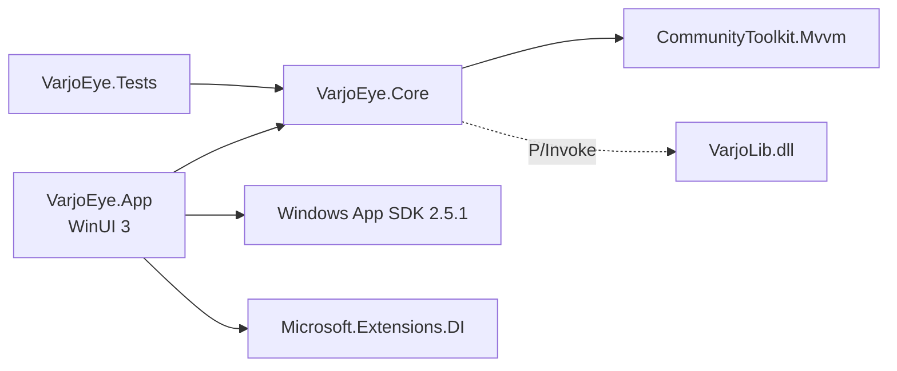
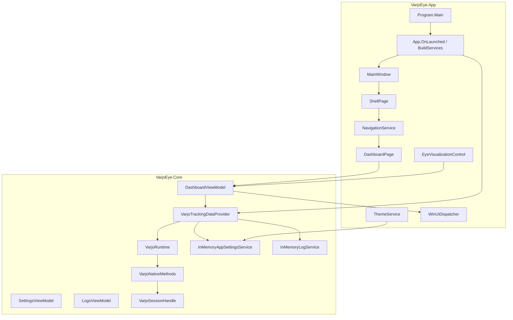
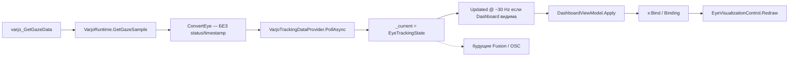
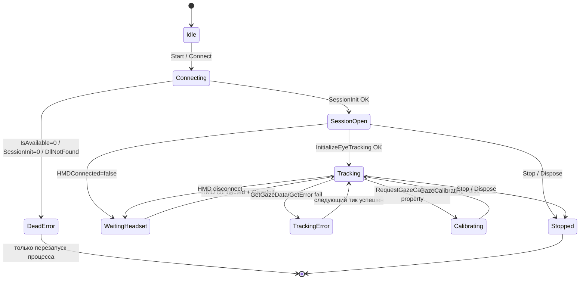
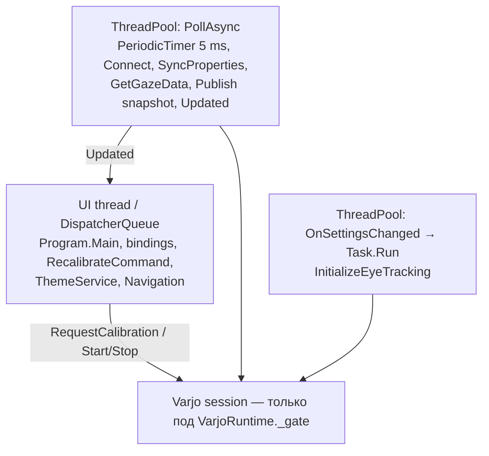

# Architecture Review — VajoEyeOSC / VarjoEye (WinUI 3)

**Репозиторий:** `VajoEyeOSC.WinUI` (`VarjoEye.sln`)  
**Дата ревью:** 2026-10-17  
**Роль:** Principal .NET Architect / Windows Native Interop / Real-Time Systems  
**Объект:** фактический код, `docs/ARCHITECTURE.md`, Varjo SDK for Custom Engines **4.14.0** (`Varjo.h`, `Varjo_types.h`)  
**Ограничения среды:** WSL2 без `dotnet` — Debug/Release/test **не запускались**. Сборка на Windows не верифицирована этим ревью. Исходники не изменялись.

Связанный Avalonia-проект `../VajoEyeOSC` **не сканировался**. Baballonia / Fusion / OSC **не считаются дефектом отсутствия**.

---

## A. Executive Summary

Архитектура — **рабочий UI-прототип с реальной, не заглушечной интеграцией Varjo Runtime**. Слои `App` / `Core` / `Tests` соблюдены: Core не тянет WinUI, native-сессия живёт в `VarjoRuntime`, poll пишет latest snapshot, Dashboard читает ~30 Гц только пока страница видима. Это правильный каркас.

Интеграция **не готова как надёжный realtime-контур**. Самые опасные разрывы: отбрасывание `leftStatus` / `rightStatus` / `status` / `captureTime`; чтение float-свойств калибровки через `GetPropertyInt`; poll, который при неудачном `Connect()` **навсегда выходит**; `Stop()` уничтожает `CancellationTokenSource` **не дожидаясь** poll-задачи; глобальный `HasTrackingData` вместо per-eye validity.

**Пять главных выводов**

1. **Varjo API вызывается по-настоящему** (`SessionInit`, `GazeInitWithParameters`, `GetGazeData`, `RequestGazeCalibration`, properties). Это не mock и не UI-only.
2. **ABI раскладки `varjo_Gaze` / `varjo_EyeMeasurements` / `varjo_Ray` совпадают с SDK 4.14.0.** Критический use-after-free сессии в горячем пути не найден: все native-вызовы сериализованы одним `_gate`, дескриптор — `SafeHandle`.
3. **Семантика gaze сломана ещё до Fusion:** статусы глаз и native timestamp выбрасываются; openness и gaze всегда публикуются вместе; Combined заранее заполняется из Varjo.
4. **Жизненный цикл сессии одноразовый при стартовом сбое** и гоночный при shutdown. Повторное появление runtime после `Connect()` failure требует перезапуска приложения.
5. **Готовность к Baballonia — условная.** Второй источник можно повесить на `ITrackingDataProvider.Current` / `Updated`, но **нельзя** включать Fusion, пока в модели нет per-eye validity, freshness и независимого openness.

**Вердикт:** `Ready with conditions`.

---

## B. Actual Architecture

### B.1 Solution

Три проекта, Central Package Management, только `x64`:

| Проект | TFM | Роль |
|---|---|---|
| `VarjoEye.App` | `net10.0-windows10.0.19041.0` | WinUI 3 unpackaged (`WindowsPackageType=None`), WASDK 2.5.1 |
| `VarjoEye.Core` | `net10.0-windows` | модели, контракты, ViewModels, Varjo P/Invoke, poll |
| `VarjoEye.Tests` | `net10.0-windows` | xUnit, только Core, `FakeTrackingDataProvider` |

Зависимости однонаправленные: **App → Core**, **Tests → Core**. Циклов нет. WinUI-типы в Core не протекают. Native-структуры (`VarjoNativeMethods.Gaze`) не выходят в UI-модели — маппятся в `GazeSample` / `EyeTrackingState`.

`VarjoEye.Core.csproj` ссылается только на `CommunityToolkit.Mvvm`. Registry/P/Invoke требуют `net10.0-windows`, не полного WASDK — это оправдано.

Избыточного дробления на проекты нет. Отдельный `VarjoEye.Varjo` / `VarjoEye.UI` сейчас не нужен.

### B.2 Project dependencies



### B.3 Component architecture



**God object?** `VarjoRuntime` совмещает connect / properties / gaze init / gaze sample / calibration. Для одного native session handle это ещё допустимо: SDK сам требует внешнюю синхронизацию сессии. `VarjoTrackingDataProvider` тяжелее — poll, mapping, UI event, settings, timeout, headset catalog. Перед Baballonia его нужно сузить до acquisition + snapshot, mapping вынести.

Отдельный application coordinator **пока не нужен**: старт/стоп завязаны на `App.OnLaunched` / `MainWindow.Closed`. Он понадобится, когда появятся камеры + fusion + OSC с независимым recovery.

### B.4 Gaze data flow



Фактическая цепочка:

`VarjoLib.varjo_GetGazeData` → `VarjoNativeMethods.GetGazeData` (`VarjoNativeMethods.cs:163`) → `VarjoRuntime.GetGazeSample` (`VarjoRuntime.cs:285–320`) → `ConvertEye` (`402–416`) → `PollAsync` (`VarjoTrackingDataProvider.cs:188–218`) → `BuildLive` / `MapEye` (`334–371`) → `_current` → `Updated` → `DashboardViewModel.OnUpdated` (`DashboardViewModel.cs:79–87`) → `IUiDispatcher.Post` → `Apply`.

### B.5 Varjo session lifecycle (фактический)

Реализованные состояния — не полная машина из ТЗ, а:



Нет состояний Recovering (для runtime), нет повторного `Connect()` после стартового failure, нет отмены калибровки.

### B.6 Startup / shutdown sequence

**Startup (фактический порядок вызовов)**

1. `Program.Main` — STA, `ComWrappersSupport`, `DispatcherQueueSynchronizationContext`, `new App()`.
2. `App.OnLaunched` → `BuildServices()` (все singleton).
3. `MainWindow` ctor → `NavigationService.Initialize` → `Navigate("tracking")` → создаётся `DashboardPage` / `DashboardViewModel` (подписка на `Updated`, `Apply(Empty)`), `OnNavigatedTo()` (`_isVisible = true`).
4. `ThemeService.Apply()`.
5. `ITrackingDataProvider.Start()` → `Task.Run(PollAsync)`.
6. `MainWindow.Activate()`.

Varjo **не** зависит от Dashboard: Start вызывается из `App`, не из страницы. Это совпадает с `docs/ARCHITECTURE.md` §6–7.

**Shutdown**

1. `MainWindow.Closed` → `ITrackingDataProvider.Dispose()`.
2. `VarjoTrackingDataProvider.Dispose`: отписка settings → `Stop()` → `_varjo.Dispose()`.
3. `Stop()`: Cancel + **Dispose CTS** + `Disconnect()` + `Publish(Empty)`. **Не await `_loop`.**
4. DI-контейнер, `DashboardViewModel`, `LogsViewModel` **не dispose**.

### B.7 Thread ownership



SDK: «Access to session must be externally synchronized» (`Varjo.h:71–72`). Это соблюдено: все native-вызовы под `VarjoRuntime._gate`. Параллельный доступ к сессии не делается.

---

## C. Findings

### ARCH-001 — Per-eye gaze status и native timestamp отбрасываются

| | |
|---|---|
| **Severity** | **High** |
| **Confidence** | Confirmed |
| **Category** | Data validity / Native interop |

**File and line:** `VarjoRuntime.cs:309–314`, `402–416`; `VarjoNativeMethods.cs:118–135`; SDK `Varjo_types.h:450–480`.

**Evidence:** `struct varjo_Gaze` содержит `leftStatus`, `rightStatus`, `status`, `captureTime`, combined `gaze`, `focusDistance`, `stability`. C#-структура поля читает (`CaptureTime, LeftStatus, RightStatus, Status, FrameNumber`), но `ConvertEye` передаёт только ray + openness + диаметры. `GazeSample` не имеет timestamp и validity.

**Root cause:** маппинг «все числа всегда валидны», без контракта SDK (`varjo_GazeEyeStatus_Invalid = 0` = глаз не виден / закрыт).

**Impact:** закрытый глаз, потеря зрачка и валидный взгляд неотличимы. Fusion не сможет выбрать источник по глазу. UI рисует origin/direction даже при `Invalid`. OSC отправит мусор в VRChat.

**Reproduction:** сценарий H — один глаз теряет pupil; `GetGazeData` вернёт `leftStatus=0`, `rightStatus=3`; приложение всё равно выставит `HasTrackingData=true` и покажет левый gaze.

**Recommended fix:** сохранить в доменной модели `GazeEyeStatus` / `GazeStatus` / `CaptureTimeNs` на каждый глаз; не копировать ray в Visual, если status < Tracked/Compensated (порог — продуктное решение). Openness из `EyeMeasurements` держать **отдельно** от gaze validity.

**Alternative:** публиковать сырой `varjo_Gaze` рядом с mapped DTO только внутри Core; UI по-прежнему видит домен.

**Effort:** S–M (модель + маппинг + тесты).  
**Regression:** визуализация может «погаснуть» на моргании — это правильнее, чем рисовать нулевой луч.

---

### ARCH-002 — Calibration quality читается как int, в SDK это float

| | |
|---|---|
| **Severity** | **High** |
| **Confidence** | Confirmed |
| **Category** | Native ABI |

**File and line:** `VarjoRuntime.cs:247–258`; `VarjoNativeMethods.cs:177–181`; SDK `Varjo_types.h:187–190`, `Varjo.h:479–494`.

**Evidence:** комментарий SDK: `GazeEyeCalibrationQuality_Left/Right` — **float [0.0–1.0]**. API для float — `varjo_GetPropertyDouble`. Код вызывает `GetPropertyInt` и мапит `3/2/1/0` → High/Medium/Low/Invalid (`VarjoTrackingDataProvider.cs:373–380`).

`varjo_GazeEyeCalibrationQuality` enum (0–3) существует отдельно (`Varjo_types.h:163–167`), но **property key документирован как float**. `GetPropertyInt` на не-int ключе — «Undefined» (`Varjo.h:492`).

**Root cause:** смешение enum качества калибровки и property type.

**Impact:** UI показывает «—» / мусор / всегда Invalid. Не краш, но ложная диагностика. Если когда-нибудь начнут решать «перекалибровать?» по этому полю — ложные решения.

**Recommended fix:** `GetPropertyDouble`; пороги 0 / низкий / средний / высокий задать явно (например 0, &lt;0.34, &lt;0.67, иначе) либо сверить поведение Base на железе. Пока не проверено на HMD — не утверждать, что enum 0–3 «на самом деле» лежит в int-property.

**Effort:** S.  
**Regression:** подписи High/Medium/Low изменятся.

---

### ARCH-003 — `Stop()` уничтожает CTS, не дожидаясь poll-задачи

| | |
|---|---|
| **Severity** | **High** |
| **Confidence** | Confirmed |
| **Category** | Lifecycle / Thread safety |

**File and line:** `VarjoTrackingDataProvider.cs:62–81`, `85–100`, `123–229`.

**Evidence:**

```csharp
run.Cancel();
run.Dispose();
_varjo.Disconnect();
Publish(EyeTrackingState.Empty);
```

`_loop` обнуляется, `await` нет. `PollAsync` использует `token` в `PeriodicTimer.WaitForNextTickAsync(token)`. Dispose CTS во время wait даёт `ObjectDisposedException`, который **не** входит в `catch (OperationCanceledException when token.IsCancellationRequested)` (`220–222`) и падает в generic `catch (Exception)` (`224–228`) — лог «Eye tracking stopped unexpectedly» и `Publish(Error)`.

Параллельно `Disconnect()` / `Dispose()` сессии. SDK требует внешней синхронизации — `_gate` это закрывает для native, но не для CTS.

**Impact:** ложная ошибка при каждом закрытии окна; гонка `Publish(Empty)` vs `Publish(Error)`; при медленном `SessionShutDown` закрытие окна не ждёт native. Если SDK зависнет в shutdown — процесс может уйти в закрытие с живым poll (окно уже closed).

**Reproduction:** сценарий G.

**Recommended fix:** сохранить `Task _loop`; `Cancel()`; `await _loop` с timeout; только потом `Dispose(CTS)` и `Disconnect()`. `Closed` сделать async-safe (блокировать close до timeout, либо fire-and-forget **с** await внутри, но без Dispose CTS до завершения).

**Effort:** S.  
**Regression:** закрытие станет чуть медленнее (ожидание тика 5 мс + shutdown) — это желательно.

---

### ARCH-004 — Стартовый провал `Connect()` убивает poll навсегда

| | |
|---|---|
| **Severity** | **High** |
| **Confidence** | Confirmed |
| **Category** | Session lifecycle / Error recovery |

**File and line:** `VarjoTrackingDataProvider.cs:128–136`.

**Evidence:** `Connect()` failure → log → `Publish(Error)` → `return`. Цикл не перезапускается. `Start()` повторно не вызывается (`if (_run is not null) return`, а `_run` остаётся ненулевым до `Stop()`). Даже если `_run` жив, задача уже закончилась — **зомби-CTS без цикла**.

Headset unplug **после** успешного Connect обрабатывается (`!headset.IsConnected`, `trackingReady = false`). Runtime, который поднялся позже старта приложения — нет.

**Impact:** сценарии B→D требуют перезапуска процесса. Для desktop-утилиты рядом с Varjo Base это реальный UX-провал.

**Recommended fix:** в poll: backoff (например 1–2 с) и повторный `Connect()`, пока не `Cancel`. Не держать `_run` после выхода из цикла без очистки.

**Effort:** S–M.

---

### ARCH-005 — `GetHeadsetStatus` / `SyncProperties` на каждом 5 мс тике

| | |
|---|---|
| **Severity** | **Medium** (для OSC/200 Гц — **High**) |
| **Confidence** | Confirmed механизм; **Requires verification** стоимость |
| **Category** | Real-time performance |

**File and line:** `VarjoTrackingDataProvider.cs:149–153`; `VarjoRuntime.cs:194`; SDK `Varjo.h:427–432`.

**Evidence:** каждый тик `PeriodicTimer(5ms)` вызывает `GetHeadsetStatus()` → `varjo_SyncProperties` + серию `HasProperty`/`GetProperty*`, затем `GetGazeData`. Всё под одним lock. `varjo_GetGazeArray` / `GetGazeDataArray` не используются — при просадке тика samples теряются (SDK: array API как раз «since last query»).

**Impact:** систематическая задержка gaze; потеря кадров при UI/GC; OSC не сможет честно держать 200 Гц. `timeBeginPeriod(1)` снижает джиттер таймера, но не стоимость SyncProperties.

**Recommended fix:** SyncProperties/headset status — 5–10 Гц; gaze — `GetGazeData` или drain через `GetGazeDataArray`; snapshot всё равно latest-value.

**Alternative:** `varjo_PollEvent` для HMD connect/disconnect вместо 200 Гц property sync.

**Effort:** M.

---

### ARCH-006 — Глобальный `HasTrackingData` и Combined = копия Varjo

| | |
|---|---|
| **Severity** | **High** для Fusion; **Medium** сейчас |
| **Confidence** | Confirmed |
| **Category** | Domain model / Extensibility |

**File and line:** `EyeTrackingState.cs`; `VarjoTrackingDataProvider.cs:334–370`; `EyeSourceState.cs`.

**Evidence:** `HasTrackingData` — один bool на оба глаза. `MapEye` всегда кладёт Varjo openness/gaze в `Visual` и в `CombinedEyeMetrics`. `BabbleEyeMetrics.Empty`. Нет source attribution, нет freshness, нет независимого validity openness vs gaze.

Документация (`ARCHITECTURE.md` §7) описывает слои как независимые поля — код Combined **уже** заполняет «fusion» данными Varjo. Второй источник либо перезапишет Combined в том же провайдере (God object), либо будет конфликтовать.

**Impact:** классическая ошибка «если gaze invalid — глаз закрыт». Varjo теряет pupil при почти закрытом веке; openness при этом может ещё жить в `EyeMeasurements`. Модель это смешивает.

**Recommended fix:** до Baballonia: `EyeSample { GazeValid, OpennessValid, CaptureTimestamp, Source }`. Combined не заполнять, пока нет Fusion. Visual для превью — явно «Varjo preview», не Combined.

**Effort:** M.

---

### ARCH-007 — `varjo_GetGazeData` требует Varjo Base Pro; fallback нет

| | |
|---|---|
| **Severity** | **Medium** |
| **Confidence** | Confirmed по SDK, **Requires verification** на конкретной установке |
| **Category** | Error handling / Product |

**File and line:** `VarjoNativeMethods.cs:162–163`; SDK `Varjo.h:384–395` (`@note: This feature requires Varjo Base Pro license`). `varjo_GetGaze` Pro не требует (`Varjo.h:381`).

**Evidence:** приложение берёт openness/диаметры только из `GetGazeData` → `EyeMeasurements`. Без Pro `GetGazeData` вернёт false и/или error. Poll уйдёт в Waiting/Error. `GetGaze` не вызывается.

**Impact:** на части машин «Varjo есть, глаз нет». Openness тогда недоступен штатно — это ограничение лицензии, его нужно **поверхностно показать**, не маскировать как «нет шлема».

**Recommended fix:** если `GetGazeData` fail с лицензионной ошибкой — fallback `GetGaze` (без measurements), UI честно без openness mm; лог уровня Warning один раз.

**Effort:** S.

---

### ARCH-008 — Нет NaN/Inf и нет различия «нет данных» vs «валидный ноль»

| | |
|---|---|
| **Severity** | **Medium** |
| **Confidence** | Confirmed (отсутствие проверки) |
| **Category** | Data validity |

**File and line:** `VarjoRuntime.ConvertEye`; `MapEye` (`Math.Clamp` на openness и `GazeDirection.X * 4`).

**Evidence:** `Math.Clamp(NaN, 0, 1)` в .NET даёт NaN. UI ProgressBar/отрисовка получают NaN. Нулевой direction при Invalid status выглядит как взгляд в центр.

`GetGazeSample`: `hasData==false` → `Success(null)` (нет сэмпла). Это правильно отличается от error. Но **валидный сэмпл с Invalid eyes** обрабатывается как live (`BuildLive`).

**Recommended fix:** вместе с ARCH-001; `double.IsFinite` на лучах.

**Effort:** S.

---

### ARCH-009 — Жёстко прошитые поля HeadsetState (частота, OSC, версия)

| | |
|---|---|
| **Severity** | **Medium** |
| **Confidence** | Confirmed |
| **Category** | Honesty of UI / Docs drift |

**File and line:** `HeadsetState.cs:33–43`, `74–96`.

**Evidence:** `For(..., Connected)` ставит `TrackingFrequency = "200 Hz"`, `VarjoRuntimeVersion = "2.15.6"`, `OscOutputStatus = "Connected"`. `FromVarjo` перебивает версию на `"Varjo Base"`, OSC на `"Disconnected"`, **частоту не перебивает**. Настройки 100 Hz / Auto на карточке не отражаются. `varjo_GetVersionString` не импортирован.

Документация говорит «живой gaze, когда шлем надет»; карточка может врать про 200 Hz и runtime version.

**Recommended fix:** частота из фактического settings + (желательно) измерения inter-frame; версия из `varjo_GetVersionString`; OSC — только реальный клиент, иначе «Not configured». Удалить `ConnectedDemo` / `ErrorDemo`, если demo-режим вырезан (`ARCHITECTURE.md` §8).

**Effort:** S.

---

### ARCH-010 — Allocations на каждый gaze sample + UI PathGeometry на кадр

| | |
|---|---|
| **Severity** | **Medium** |
| **Confidence** | Confirmed allocations; **Requires verification** влияние GC |
| **Category** | Performance / GC |

**Evidence (hot path ~200 Гц):** каждый принятый кадр: `GazeSample`, 2×`EyeTrackingEye`, 4×`Vector3Value`, `EyeTrackingState`, `HeadsetState`, 2×`CameraState`, 2×`EyeSourceState`, 2×`EyeSourceVisual`, 2×`VarjoEyeMetrics`, 2×`CombinedEyeMetrics`, строки калибровки. `Publish` сравнивает `ReferenceEquals` — всегда false, потому что `new`.

UI ~30 Гц: `EyeMetricsDisplay.Update` — куча `ToString` / `"0.00 mm"`; `EyeVisualizationControl.Redraw` создаёт новые `PathGeometry`/`BezierSegment` на каждый DP change (`EyeVisualizationControl.cs:261–279`). Кисти в ctor — хорошо; геометрию нет.

`DispatcherQueue`: не на каждый sample (правильно, 33 мс). Но `OnUpdated` не коалесцирует: при застое UI очередь накопится пачками `Apply(state)` по старым снимкам (сценарий I).

**Recommended fix:** mutable snapshot или `record struct` + object pool не обязателен на этом этапе; достаточно не строить Combined/Babble, пока их нет; коалесцировать UI post (одно pending). Геометрию глаза кэшировать при неизменном размере/openness.

**Не выдумывать** latency/FPS. Профилировать на Windows с HMD.

**Effort:** M.

---

### ARCH-011 — `LogsViewModel` обновляется всегда, коллекция без верхней границы

| | |
|---|---|
| **Severity** | **Low** сейчас; **Medium** если начнут логировать кадры |
| **Confidence** | Confirmed |
| **Category** | Diagnostics |

**File and line:** `InMemoryLogService.cs:24–31`; `LogsViewModel.cs:34–49`.

**Evidence:** `Add` стреляет `Changed` на потоке вызывающего (poll). VM всегда делает `Clear()` + полный rebind. Нет cap. Нет паузы, когда Logs не видимы.

Сейчас логи не per-sample — ок. Перед Baballonia diagnostic CSV в память без лимита будет расти.

**Recommended fix:** ring buffer N (например 2000); Logs подписывается только `OnNavigatedTo`; не логировать gaze.

**Effort:** S.

---

### ARCH-012 — Service locator и незакрытый DI

| | |
|---|---|
| **Severity** | **Low** |
| **Confidence** | Confirmed |
| **Category** | Composition |

**File and line:** `App.xaml.cs:20–22, 43–59`; `NavigationService.cs:12–17, 64–69`; `ThemeService.cs:23–28`.

**Evidence:** `App.Services`, `App.MainWindow` static. `NavigationService` резолвит страницы через `IServiceProvider`. `ServiceProvider` не dispose. ViewModels с `IDisposable` (`DashboardViewModel`, `LogsViewModel`) не вызываются.

Для unpackaged WinUI с одним окном это приемлемо. Не блокер.

**Recommended fix:** при закрытии вызвать `DashboardViewModel.Dispose` / `LogsViewModel.Dispose` и `ServiceProvider.Dispose` после stop tracking.

**Effort:** S.

---

### ARCH-013 — Калибровка с UI-потока, без cancel, без защиты от re-entry

| | |
|---|---|
| **Severity** | **Low** (native, скорее всего, не блокирует) / **Medium** если SDK ждёт UI |
| **Confidence** | Likely |
| **Category** | Calibration lifecycle |

**File and line:** `DashboardViewModel.cs:50–66`; `VarjoRuntime.cs:323–368`; SDK `Varjo.h:336–371`.

**Evidence:** `RecalibrateCommand` синхронно вызывает native на UI-потоке. Нет `IsCalibrating` disable кнопки. `varjo_CancelGazeCalibration` не импортирован. Закрытие во время калибровки — только `SessionShutDown`. Повторный request во время калибровки не фильтруется (SDK сам может отвергнуть).

Документация: «Native gaze calibration уже вызывается кнопкой Recalibrate» — **верно**, это не заглушка.

**Recommended fix:** не писать свою калибровку. Импортировать cancel; disable кнопки пока `IsGazeCalibrating==true`; не держать UI на native, если профилирование покажет блок.

**Effort:** S.

---

### ARCH-014 — `DllImportResolver` глотает не все ошибки загрузки

| | |
|---|---|
| **Severity** | **Low** |
| **Confidence** | Confirmed |
| **Category** | Native loading |

**File and line:** `VarjoNativeMethods.cs:33–46`.

**Evidence:** ловятся только `DllNotFoundException` и `BadImageFormatException`. `NativeLibrary.Load` также бросает `DllNotFoundException` для зависимостей; другие исключения (доступ) всплывут из static ctor при первом P/Invoke — частично ловятся в `Connect()`. Пути: Uninstall registry `Varjo Base` + `ProgramFiles\Varjo\varjo-compositor\VarjoLib.dll`. Абсолютных путей профиля в csproj нет — переносимо.

**Recommended fix:** логировать неудачные пути без PII; не обязательно.

---

### ARCH-015 — ViewModels в Core + настройки, которые ни на что не влияют

| | |
|---|---|
| **Severity** | **Low** |
| **Confidence** | Confirmed |
| **Category** | Maintainability / Docs |

**Evidence:** `GazeSmoothing`, `BlinkSensitivity`, OSC host/port, inference device пишутся в память и **не читаются** провайдером (кроме frequency/raw filter). Это совпадает с «persistence нет, OSC нет». Не баг, но ложный affordance.

ViewModels в Core упрощают тесты и нарушают «Core = domain only». Для прототипа это сознательное решение (`ARCHITECTURE.md` §4) — **не переписывать**.

---

## D. Native Interop Audit

Сопоставление с **Varjo SDK 4.14.0** (`/mnt/c/Users/Katsu/Downloads/Varjo_SDK_for_Custom_Engines_4.14.0/varjo-sdk/include`).

Windows x64: `cdecl` vs `stdcall` на практике схлопывается в Microsoft x64 ABI. `VARJO_API` = `__declspec(dllimport)` без явного convention — MSVC C default cdecl. Риск calling convention на x64 **низкий**.

| Контракт | C SDK | C# | Статус |
|---|---|---|---|
| `varjo_IsAvailable` | `varjo_Bool` (int32) | `int` cdecl | OK |
| `varjo_SessionInit` | `varjo_Session*` | `IntPtr` | OK |
| `varjo_SessionShutDown` | `void(session*)` | `IntPtr` в `SafeHandle.ReleaseHandle` | OK, владелец один |
| `varjo_IsGazeAllowed` | `varjo_Bool(session*)` | `int(VarjoSessionHandle)` | OK |
| `varjo_GazeInitWithParameters` | `GazeParameters*, int32` | `[In] GazeParameter[], int` | OK раскладка `{char*,char*}` ↔ два `IntPtr`; строки UTF-8 CoTaskMem, free после синхронного вызова — **Likely OK** |
| `varjo_GetGazeData` | `Bool, Gaze*, EyeMeasurements*` | `int, out Gaze, out EyeMeasurements` | Раскладка структур **OK** (см. ниже). API Pro-only |
| `varjo_GetGaze` | returns `varjo_Gaze` | не импортирован | Fallback отсутствует |
| `varjo_GetGazeArray` / `GetGazeDataArray` | drain queue | не импортированы | Потеря samples при медленном poll |
| `varjo_RequestGazeCalibration` | `void` | `void` | OK |
| `varjo_CancelGazeCalibration` | `void` | не импортирован | Нет cancel |
| `varjo_GetError` | `int64` | `long` | OK; **очищает** error status (SDK) — код читает после каждой операции, ок |
| `varjo_GetErrorDesc` | `const char*` | `IntPtr` → UTF8 | OK |
| `varjo_SyncProperties` | `void` | `void` | OK, слишком часто |
| `varjo_HasProperty` / `GetPropertyBool` | `int64 key`, `Bool` | `long`, `int` | OK |
| `varjo_GetPropertyInt` | `int32` | `int` | OK как сигнатура; **неверный ключ** для quality (ARCH-002) |
| `varjo_GetPropertyDouble` | `double` | **не импортирован** | Нужен для 0xA004/0xA005 |
| `varjo_GetPropertyString` / `Size` | `char*`, `uint32` | `byte[]`, `uint` | OK UTF-8 |
| Property keys 0xE001, 0xE002, 0xA000, 0xA001, 0x2000, 0xA003, 0xA004, 0xA005 | совпадают | совпадают | Keys OK |
| `varjo_Ray` | `double origin[3]; double forward[3]` | 6×`double` named fields | **OK 48 bytes** |
| `varjo_Gaze` | 3 rays + 2 double + 5×int64 + 2 double = **216** | те же поля Sequential | **OK** |
| `varjo_EyeMeasurements` | 2×int64 + 9×float = **52** | те же | **OK** |
| `varjo_Bool` marshalling | int32 0/1 | `int` ≠ `bool` | Правильно (не marshaled bool) |
| Callbacks | нет в используемом API | нет | N/A |
| `SafeHandle` session | opaque pointer | `SafeHandleZeroOrMinusOneIsInvalid` | OK; double-free предотвращён |
| DLL load | — | resolver Base Uninstall + Program Files | OK, без hardcoded user profile |

**Не проверено в этом ревью (нет HMD / нет запуска):** фактический sizeof на рантайме, поведение `GetGazeData` без Pro, копирует ли `GazeInitWithParameters` строки до return, зависание `SessionShutDown`.

**Use-after-free / double-free:** не подтверждены. Сессия не отдаётся наружу. `Connect` failure path делает `candidate?.Dispose()` в `finally` и обнуляет после передачи в `_session`.

---

## E. Threading & Lifecycle Audit

| Работа | Кто стартует | Поток | Владелец | Стоп | Ошибки | Повторный запуск |
|---|---|---|---|---|---|---|
| Poll gaze | `App.OnLaunched` → `Start` | ThreadPool `Task.Run` | `VarjoTrackingDataProvider` | `Stop` cancel CTS **без await** | log + Error snapshot; Connect fail = exit | `Start` no-op пока `_run != null` даже если задача мертва |
| Native session | poll `Connect` | poll, под `_gate` | `VarjoRuntime` | `Disconnect`/`Dispose` | `OperationResult` | Connect идемпотентен если `_session != null`; после Disconnect можно снова, **но poll уже мёртв** |
| Gaze init | poll при HMD connect; settings `Task.Run` | poll или пул | `VarjoRuntime` | флаг сбрасывается в Disconnect | Failure snapshot | re-init если frequency/filter сменились |
| Calibration | UI command | **UI thread** | Runtime | нет cancel | InfoBar | повтор не заблокирован |
| UI apply | `Updated` | Dispatcher | `DashboardViewModel` | `_isVisible=false` | нет | `OnNavigatedTo` Apply(Current) |
| Theme | settings.Changed | Dispatcher Low | `ThemeService` | нет | swallow Exception | каждый Changed |
| Logs refresh | log.Add | Dispatcher | `LogsViewModel` | нет (Dispose не вызывается) | нет | — |
| Timer 1 ms | poll | process-wide winmm | `WindowsTimerResolution` | dispose при выходе PollAsync | warning | — |

**Deadlock:** классического UI+lock нет: UI `Recalibrate` берёт `_gate` на коротком native; poll ждёт. Если `RequestGazeCalibration` блокирует до конца UI калибровки **и** калибровка требует UI приложения — потенциальный deadlock. SDK описывает trigger UI **Varjo Base**, не нашего окна — **Likely нет deadlock**. Requires HMD verification.

**Race:** Stop vs Poll (ARCH-003); settings init vs poll init — сериализованы `_gate`.

**Busy wait:** нет. `PeriodicTimer`.

**async void:** нет.

**Неограниченная очередь:** Dispatcher `TryEnqueue` без coalesce (ARCH-010); логи без cap (ARCH-011).

---

## F. Performance Assessment

### Подтверждено статикой

- Latest-value snapshot есть; UI не на 200 Гц — **хорошо**.
- `DispatcherQueue` не на каждый sample — **хорошо**.
- На каждый sample — граф immutable records (ARCH-010).
- `SyncProperties` 200 Гц (ARCH-005).
- `ReferenceEquals` в `Publish` мёртв.
- `EyeVisualizationControl` перестраивает `PathGeometry` каждый кадр.
- `LogsViewModel.Refresh` полный rebuild.
- LINQ в горячем gaze-цикле нет.
- LOH: маловероятно (маленькие records). `GetPropertyString` buffer ≤ 1024.

### Гипотезы (нужен профайлер + HMD)

- Укладывается ли итерация в 5 мс.
- Джиттер `PeriodicTimer` даже с `timeBeginPeriod(1)`.
- Потеря кадров `GetGazeData` vs array drain.
- GC gen0 на 200 Гц allocations.
- Стоимость `Updated` multicast когда появятся OSC+Fusion.

Цифры latency/FPS/allocation rate **не приводятся**.

`timeBeginPeriod(1)` — осознанный, процесс-wide; документировать как побочный эффект (глобальный таймер Windows).

---

## G. Integration Readiness

### Varjo API — 6.5 / 10

Реальные вызовы, SafeHandle, lock, DLL resolver, калибровка, частота/фильтр из Settings. Дыры: validity, timestamps, Pro API, recovery, shutdown, property types.

### Baballonia — 4 / 10

Камеры — статичные PNG (`CameraState.Waiting`). Нет capture, нет ONNX, нет выбора CPU/GPU (список в Settings мёртвый). Параллельный provider **архитектурно возможен** как второй `ITrackingDataProvider` или отдельный интерфейс, если **не** пихать в `VarjoTrackingDataProvider` и **не** писать в Combined. Сейчас Combined уже занят Varjo — конфликт.

Независимый lifecycle камеры vs Varjo сессии **не спроектирован**, но и не запрещён: tracking provider не владеет UI.

### Fusion Engine — 3 / 10

Не хватает: per-eye validity, per-eye confidence, capture vs processing timestamp, freshness, source attribution, раздельный gaze/openness, независимый выбор источника на глаз. Текущая модель **подталкивает** к переключению всего глаза целиком.

### OSC / VRChat — 4 / 10

Настройки IP/port/флаг есть в памяти. Клиента нет. Подписка на `ITrackingDataProvider.Updated` или чтение `Current` **не требует** DashboardViewModel — это плюс. Минусы: нет timestamp/age, частота snapshot = частота poll overwrite (OK), UI event 30 Гц **нельзя** использовать как OSC clock, shutdown не ждёт flush, «OSC Connected» на карточке врёт до `FromVarjo`.

### VRChat avatar parameters

Нет маппинга. Не дефект этапа.

---

## H. Technical Debt

| Долг | Трогать сейчас? |
|---|---|
| ViewModels в Core | Нет. Тесты живут этим. |
| In-memory settings/logs | Нет, пока нет persistence-этапа. |
| Мёртвые GazeSmoothing / BlinkSensitivity / GPU list | Не реализовывать «на всякий случай». Либо скрыть, либо подписать «unused». |
| `HeadsetState.ConnectedDemo` leftovers | Да, мелочь — путает. |
| `AllowUnsafeBlocks` в App без unsafe | Косметика. |
| Navigation через service locator | Нет, Frame не умеет DI. |
| Static `App.MainWindow` | Нет, пока одно окно. |
| Неимпортированные GetGazeArray / PollEvent / GetVersionString | Да, точечно, не «весь SDK wrapper». |
| Отдельный проект Varjo | Нет. |

---

## I. Refactoring Roadmap

### P0 — Blockers

Нет доказанного memory-corruption / double-free. **Немедленного P0 по native safety нет.**

Условно P0 по продукту, не по памяти:

1. **ARCH-003** shutdown CTS — `VarjoTrackingDataProvider.Stop/Dispose`. Критерий: закрытие окна не пишет Error; poll задача завершена до `SessionShutDown`; нет ODE.
2. **ARCH-001** не блокер запуска, но блокер **корректного** tracking. Если «немедленно» = «не врать про глаза» — чинить до Baballonia, можно параллельно с P1.

### P1 — Before Baballonia

| Шаг | Файлы | Критерий готовности |
|---|---|---|
| Per-eye status + captureTime в домене | `EyeTrackingSettings.cs` / новые records, `VarjoRuntime.ConvertEye`, `MapEye`, `EyeMetricsDisplay` | Тест: left Invalid / right Tracked → UI и snapshot различают; openness не обнуляется только из-за Invalid gaze |
| Quality через double | `VarjoNativeMethods`, `VarjoRuntime.GetHeadsetStatus` | Нет `GetPropertyInt` на 0xA004/0xA005 |
| Retry Connect | `VarjoTrackingDataProvider.PollAsync` | Без Base при старте → Base later → Connected без рестарта приложения (можно симулировать fake runtime) |
| Не заполнять Combined | `MapEye` | Combined Empty пока нет fusion |
| Вынести mapping из provider | новый mapper, тесты без DLL | Fake samples → ожидаемый `EyeTrackingState` |
| Тесты runtime-оркестрации | новый fake `IVarjoRuntime` | Start/stop/disconnect/reconnect/init fail покрыты |

Не добавлять ONNX, камеры, circuit breaker, structlog, новые проекты.

### P2 — Before OSC

| Шаг | Файлы | Критерий |
|---|---|---|
| Снизить SyncProperties | poll loop | Headset status ≠ 200 Гц |
| Drain или документировать latest-only | optional `GetGazeDataArray` | Метрика dropped frames (счётчик, не на каждый лог) |
| Timestamp + age на snapshot | `EyeTrackingState` | OSC может дропать stale > N мс |
| OSC как отдельный subscriber | новый сервис в `BuildServices` | Не трогает ViewModel; стоп на Closed |
| Coalesce UI dispatcher | `DashboardViewModel.OnUpdated` | При паузе UI нет шторма Apply |

### P3 — Optional

- Честная частота/версия на HeadsetCard.
- Cap логов, пауза подписки Logs.
- Кэш геометрии глаза.
- Dispose VM + ServiceProvider.
- `GetGaze` fallback без Pro.
- Cancel calibration.
- Убрать demo statics.

---

## J. Architecture Scorecard

| Ось | Оценка | Почему |
|---|---|---|
| Overall architecture | **6.5** | Чистые границы прототипа, реальный Varjo path, но validity и lifecycle не доведены. |
| Modularity | **7** | App/Core/Tests правильные; provider уже толстый. |
| Dependency management | **7.5** | CPM, x64, unpackaged, Core без WASDK. DI lifetimes в целом верные. |
| Native interoperability | **5.5** | Раскладки структур верные, SafeHandle верный; семантика полей и типы properties — нет. |
| Session lifecycle | **5** | Один владелец и lock есть; нет retry; shutdown гонка; зомби после Connect fail. |
| Thread safety | **6** | Сессия защищена; CTS/Stop нет; UI Recalibrate на UI-потоке. |
| Real-time readiness | **6** | Snapshot + 30 Гц UI — правильная идея; 200 Гц SyncProperties и alloc мешают. |
| UI architecture | **7.5** | MVVM, code-behind тонкий, навигация не стопает backend, Mica/theme аккуратно. |
| Error handling | **5** | DLL/entry/arch пойманы; recovery слабый; Pro license не выделен; shutdown → ложный Error. |
| Testability | **6** | VM тестируются фейком; native/mapping/lifecycle — нет. Среда без dotnet в WSL. |
| Maintainability | **7** | Код короткий, читаемый, docs близки к коду с оговорками. |
| Extensibility | **5.5** | Точка расширения snapshot есть; Combined и HasTrackingData её портят. |

---

## K. Final Verdict

1. **Насколько качественно реализована интеграция Varjo?**  
   Выше среднего для прототипа: не заглушка, ABI структур сверен с SDK 4.14.0, сессия владеется SafeHandle, poll отделён от UI. Ниже приемлемого для продукта: выкинуты status/time, неверный тип calibration quality, нет recovery runtime, грубый shutdown.

2. **Есть ли ошибки, которые нужно чинить немедленно?**  
   Нет подтверждённого повреждения памяти. Чинить сразу: shutdown (ARCH-003), не убивать poll после Connect fail (ARCH-004), не врать про validity глаз (ARCH-001) перед любым вторым источником.

3. **Можно ли безопасно приступать к Baballonia?**  
   **Нет, не в тот же провайдер и не в Combined.** Можно начинать **параллельный** camera/ONNX сервис после P1-модели validity. Иначе Fusion унаследует «Varjo invalid ⇒ closed».

4. **Нужны ли дополнительные проекты?**  
   **Нет.** App/Core/Tests достаточно. Третий проект появится, когда native+ONNX начнут тянуть лишние зависимости в Core — не сейчас.

5. **Готовность к независимому Fusion Engine?**  
   **Низкая.** Нет per-eye validity, timestamps, freshness, раздельного openness/gaze, пустого Combined.

6. **Главный технический риск?**  
   Не WinUI и не DI, а **потерянный контракт Varjo gaze status** плюс **одноразовый poll lifecycle**. Первый даёт неверные данные в VRChat; второй — «не работает, пока не перезапустишь».

7. **Три изменения с максимальной пользой при минимуме затрат**  
   - Await poll + корректный Cancel перед `SessionShutDown`.  
   - Прокинуть `leftStatus/rightStatus/status/captureTime` в snapshot; не рисовать invalid gaze.  
   - Retry `Connect()` с backoff; `GetPropertyDouble` для quality.

8. **Что категорически не стоит переписывать?**  
   - Unpackaged WinUI 3 и разделение App/Core.  
   - Latest-value snapshot и «навигация ≠ stop Varjo».  
   - Singleton VM + кэш страниц.  
   - `SafeHandle` + единый lock на сессию (не заменять на pipeline из очередей без нужды).  
   - Не копировать Avalonia UI. Не писать свою hardware calibration. Не выделять Fusion/OSC проекты заранее. Не добавлять circuit breaker и замену логирования.

---

## Сценарный анализ (обязательный)

### A — Нормальный запуск (шлем + Base)

`Start` → `Connect` (`IsAvailable`, `SessionInit`, `GetError`) → timer 1 ms → цикл: `SyncProperties` + HMD connected → `InitializeEyeTracking` (частота/фильтр) → `GetGazeData` → `BuildLive` → snapshot → 30 Гц UI.  
**Работает по коду**, если DLL находится и Pro-API доступен. Частота на карточке всегда «200 Hz». Validity глаз игнорируется.

### B — Шлема нет, Base есть

`Connect` успешен (runtime available). `IsConnected=false` → `Disconnected("Waiting for headset")`, цикл жив.  
**OK.**

### C — Потеря соединения во время tracking

`IsConnected=false` → `trackingReady=false`, `lastGaze=null`, Waiting. Сессия **не** закрывается.  
**OK для HMD unplug.** Обрыв самого runtime, который начинает возвращать errors: `GetHeadsetStatus` Failure → `Error` snapshot, `trackingReady=false`, цикл жив, повторный init при появлении данных.  
**Частично OK.**

### D — Восстановление

HMD снова connected → снова `InitializeEyeTracking` → gaze.  
Runtime, которого не было на старте: **не восстанавливается** (ARCH-004).

### E — Калибровка во время poll

UI → `RequestGazeCalibration` под `_gate` (poll ждёт). Poll дальше читает `IsGazeCalibrating` → статус «Calibrating». Cancel нет. Кнопка не дизейблится. UI может блокироваться, если native ждёт.

### F — Dashboard → Settings → Logs → Dashboard

`OnNavigatedFrom` только `_isVisible=false`; poll жив. Возврат `OnNavigatedTo` + `Apply(Current)`. Двойной подписки нет (singleton VM, подписка в ctor).  
**OK, совпадает с docs.**

### G — Закрытие во время tracking

`Closed` → `Dispose` → Cancel/Dispose CTS/Disconnect без await. Риск ODE и ложного Error (ARCH-003). `CancelGazeCalibration` нет.

### H — Один глаз без pupil

Native отдаст разный `leftStatus/rightStatus`. Код оба глаза кладёт в live Combined/Visual. `HasTrackingData=true`.  
**Некорректно.**

### I — UI завис

Poll продолжает overwrite `_current`. `Updated` копит `Post(Apply)` каждые 33 мс. После отвисания — пачка PropertyChanged и Redraw. Snapshot для будущего OSC свежий; UI временно отстаёт, затем догоняет пачкой.

### J — Varjo + Baballonia + Fusion + OSC (будущее)

Точка чтения snapshot есть. Мешает: Combined уже заполнен, нет timestamps/validity, provider — единственный publisher, OSC если подпишется на `Updated` получит 30 Гц dirty, не 200 Гц. Нужен отдельный consumer на `Current` с собственным таймером.

---

## Расхождения документации и кода

| Docs (`ARCHITECTURE.md`) | Код |
|---|---|
| Backend не зависит от навигации | Верно |
| Recalibrate = native | Верно |
| Demo/mock удалены | `HeadsetState.ConnectedDemo` / `ErrorDemo` / hardcoded 2.15.6 остались |
| TrackingFrequency живая | Всегда «200 Hz» при Connected |
| Combined слой | Заполняется копией Varjo, не fusion |
| ~200 Гц poll | Запрос 5 мс; ещё и SyncProperties |
| Tests покрывают Recalibrate через provider | Только VM + fake, не `VarjoRuntime` |
| `varjo_GetVersion` / живая версия Base | Не используется |

---

## Сборка и тесты

```
WSL: dotnet: command not found
```

Команды, которые **нужно выполнить на Windows** (не прогонялись здесь):

```powershell
dotnet build VarjoEye.sln -c Debug -p:Platform=x64
dotnet build VarjoEye.sln -c Release -p:Platform=x64
dotnet test VarjoEye.sln -p:Platform=x64
```

Существующие тесты: VM init, live fake snapshot, hidden dashboard, layer toggles, Recalibrate message, Train Model stub, HeadsetCatalog, settings memory, logs filter. **Нет:** session, mapping validity, Stop/Start, reconnect, calibration+poll, fake `IVarjoRuntime`.

Минимальный полезный набор перед Baballonia: fake `IVarjoRuntime` + тесты provider (connect fail retry, hmd unplug, per-eye invalid, stop waits, settings reinit). Без железа.

---

## Console summary (для оператора ревью)

- **Overall:** 6.5 / 10  
- **Severity:** Critical 0 · High 5 (ARCH-001, 002, 003, 004, 006) · Medium 5 · Low 5  
- **Top 5 рисков:** validity глаз выкинута; GetPropertyInt на float quality; Stop vs CTS; Connect fail убивает poll; Combined/HasTrackingData блокируют Fusion  
- **Top 3 фикса:** await Stop; прокинуть status+timestamp; retry Connect + GetPropertyDouble  
- **Вердикт:** `Ready with conditions`  
- **Следующий этап:** P1 доменная модель gaze (per-eye validity + timestamp) и починка lifecycle poll; **не** Baballonia в тот же класс.
